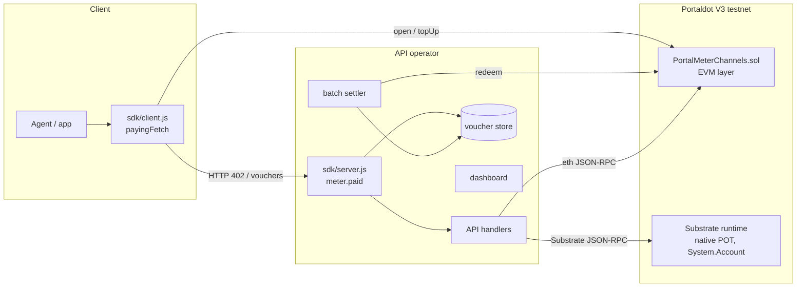
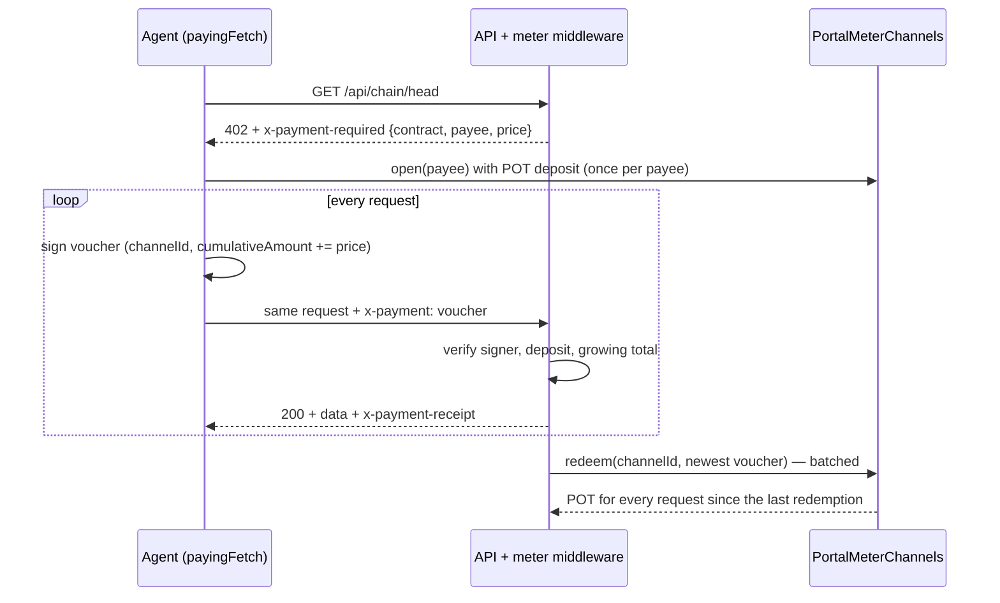

# PortalMeter

**Pay-per-request APIs on Portaldot** — HTTP `402 Payment Required` plus off-chain signed vouchers over native-POT payment channels.

DEMO: _video link — coming with the final submission_ · Track: **Modular Cloud & Middleware** · Portaldot Hacker House 2026

## Project Overview

### Problem Statement

AI agents and scripts increasingly buy data and compute from APIs, but paying for an API today means API keys, monthly plans and card billing — none of which an autonomous agent can set up. Paying on-chain solves the account problem but not the economics: one blockchain transaction per API call is slower than the call itself and costs more gas than the call is worth.

### Solution

PortalMeter keeps the open, account-free part of on-chain payments and removes the per-call transaction:

- **One deposit, many calls.** The client locks POT in a payment channel once; every request carries an EIP-712 voucher for the new running total.
- **No gas per request.** The server verifies a voucher with a signature check and a cached channel read, in milliseconds.
- **Batched settlement.** The API operator redeems only the newest voucher, whenever it is worth it — many paid requests per on-chain transaction.
- **Plain HTTP.** A `402` response and two headers. The JS SDK wraps it all in one `fetch()` for clients and one `paid(price, handler)` middleware for servers.

### Blockchain Relevance

- A Solidity payment-channel contract holds native POT on Portaldot V3's EVM layer and enforces every payout rule: only the payer's signature counts, totals only grow, nothing above the deposit, a close window protects the payee, the payer gets the rest back.
- All gas is paid in POT; every paid API call ends up as POT moving on Portaldot.
- The demo API reads the same account from both sides of the Portaldot runtime: the EVM balance through `eth_getBalance` and the native `System.Account` record through Substrate RPC, using pallet-revive's address mapping (`h160 ++ 0xEE×12`, confirmed with the runtime's `ReviveApi_account_id`).

## Technical Architecture

### Architecture diagram





### Protocol `portalmeter-channel-v1`

| Header | Direction | Content (base64url JSON) |
| --- | --- | --- |
| `x-payment-required` | server → client, with `402` | `scheme`, `chainId`, `contract`, `payee`, `price` (wei), `reason`, optional `expected` |
| `x-payment` | client → server | `channelId`, `cumulativeAmount`, `signature` — EIP-712 `Voucher(bytes32 channelId,uint256 cumulativeAmount)`, domain `PortalMeter` / `1` |
| `x-payment-receipt` | server → client, with `200` | `channelId`, `charged`, `cumulativeAmount`, `remaining` |

A server publishes its price list at `/.well-known/portalmeter`.

### Core tech stack

- **Blockchain platform:** Portaldot V3 testnet (Substrate runtime with pallet-revive EVM layer), chain id `420420777`, gas in POT.
- **Smart contract language:** Solidity 0.8.28.
- **Frontend:** dependency-free HTML/JS dashboard served by the API.
- **Other components:** Node.js SDK built on viem; Substrate JSON-RPC client using @polkadot/util-crypto; Hardhat 3 for compilation and tests.

## Smart Contracts

### Contract file directory

```
contracts/
└── PortalMeterChannels.sol
```

### Key contract functions — `PortalMeterChannels`

| Function | Who | What it does |
| --- | --- | --- |
| `open(payee)` payable | payer | Locks `msg.value` POT in a new channel; emits `ChannelOpened(channelId, …)` |
| `topUp(channelId)` payable | anyone | Adds POT to an open channel |
| `redeem(channelId, cumulativeAmount, signature)` | payee | Pays `cumulativeAmount − claimed`; rejects replays, totals above the deposit, foreign or malleable signatures and vouchers for another channel |
| `requestClose(channelId)` | payer | Starts the `closeDelay` window in which the payee can still redeem |
| `release(channelId)` | payee | Gives up further claims so the payer can withdraw immediately |
| `withdraw(channelId)` | payer | After the window, refunds whatever was not redeemed |
| `voucherDigest`, `remaining`, `channels` | view | Voucher hash, unspent balance, channel record |

### Deployment instructions

```bash
npm run compile
node --env-file=.env scripts/deploy.js   # writes deployments/portaldot-testnet.json
```

`PAYEE_KEY` in `.env` deploys and later redeems. On Portaldot an EVM key's native account is `h160 ++ 0xEE×12`; fund that SS58 address (or the EVM address directly) with test POT.

## Installation & Setup

### Requirements

- Node.js 22 or newer, npm
- Two testnet keys with test POT for the testnet run (payer and payee); none needed for the local run

### Steps

1. Clone the repository

   ```bash
   git clone https://github.com/xkuzmi/portaldot-hackathon-2026-portalmeter-xkuzmi.git
   cd portaldot-hackathon-2026-portalmeter-xkuzmi
   ```

2. Install dependencies and run the tests

   ```bash
   npm install
   npm test
   ```

3. Compile & deploy — Portaldot V3 testnet

   ```bash
   cp .env.example .env    # set PAYEE_KEY and PAYER_KEY
   npm run compile
   node --env-file=.env scripts/deploy.js
   ```

4. Launch the API and dashboard, then run the paying agent

   ```bash
   node --env-file=.env demo/server.js        # http://localhost:8402
   node --env-file=.env demo/agent.js 10      # 10 rounds × 3 paid calls
   ```

### Local run without testnet funds

A local chain with Portaldot's chain id stands in for the EVM layer; native-chain fields are still read live from the public Portaldot node.

```bash
npm run node:local
```

In a second terminal (Hardhat's public development keys — local use only):

```bash
export PORTALDOT_EVM_RPC=http://127.0.0.1:8545 DEPLOYMENT_NAME=local
export PAYEE_KEY=0x59c6995e998f97a5a0044966f0945389dc9e86dae88c7a8412f4603b6b78690d
export PAYER_KEY=0xac0974bec39a17e36ba4a6b4d238ff944bacb478cbed5efcae784d7bf4f2ff80
npm run deploy && SETTLE_EVERY_MS=15000 npm run api
```

In a third terminal with the same exports: `npm run agent -- 5`, then open http://localhost:8402.

### Repository layout

| Path | What |
| --- | --- |
| `contracts/PortalMeterChannels.sol` | Payment-channel contract |
| `sdk/client.js` | `createPayingFetch` — handles 402, opens/tops up channels, signs vouchers, keeps requests in voucher order |
| `sdk/server.js` | `createMeter` — `paid(price, handler)` middleware, voucher store, `settle()` |
| `sdk/voucher.js` | Shared EIP-712 voucher and header encoding |
| `sdk/portaldot.js` | Chain definition, Substrate RPC client, EVM → native address mapping |
| `demo/server.js` | Portaldot Chain Data API: `/api/chain/head`, `/api/account`, `/api/blocks/recent` |
| `demo/agent.js` | Agent that buys chain data per request |
| `demo/dashboard.html` | Live requests, channels and settlements (served at `/`) |
| `scripts/deploy.js` | Testnet deployment |
| `test/` | 9 contract tests and an end-to-end HTTP test of the SDK |

## Demo

- **Video:** _with the final submission_
- **Live demo:** run locally with the steps above; a hosted endpoint is planned.
- **Testnet deployment:** _pending testnet POT_ — contract address, deployment transaction and redemption transactions will be listed here.
- **Test data:** the agent buys `/api/chain/head` (0.001 tPOT), `/api/account?address=…` (0.002 tPOT) and `/api/blocks/recent?n=5` (0.005 tPOT). In the local run, 12 paid requests settled in a single redemption transaction.

## Roadmap

### Completed

- Payment-channel contract with EIP-712 vouchers, close window and refunds
- Server middleware with batched settlement; paying `fetch` client with automatic channel opening and top-ups
- Paid Portaldot chain-data API reading both the EVM and native layers, paying agent, live dashboard
- Contract tests and an end-to-end SDK test (402 → open → paid calls with a top-up → one redemption; replayed, forged and malformed vouchers rejected)

### Next phase

- Testnet deployment and live demo transactions
- ERC-20 channels (USDT on Portaldot) next to native POT
- Python client and Express/Fastify adapters
- Directory of PortalMeter-enabled APIs read from `/.well-known/portalmeter`
- Metered Portaldot RPC and indexer endpoints as the first production use

## Security notes

- Vouchers are bound to the chain id, the contract and the channel; high-`s` signatures are rejected.
- The server never accepts an increment below the price and commits a voucher only after all checks, so concurrent requests cannot spend the same increment.
- The server stops accepting vouchers 2 minutes before a closing channel's deadline, so its last redemption still lands.
- The operator's risk is bounded by the unredeemed amount and controlled by `SETTLE_EVERY_MS` / `SETTLE_MIN_TPOT`.
- Not audited; testnet only.

## Team

- **Team name:** xkuzmi
- **Members & roles:** xkuzmi — solo developer (contracts, SDK, demo)
- **Contact (hackathon communication only):** via the project's DoraHacks page or GitHub issues

Uses [viem](https://viem.sh), [Hardhat](https://hardhat.org), [solc](https://github.com/ethereum/solc-js) and [@polkadot/util-crypto](https://github.com/polkadot-js/common). The 402 flow is inspired by the x402 standard; the channel design follows classic unidirectional payment channels. Developed with AI coding assistance.

## License

MIT — see [LICENSE](LICENSE).
