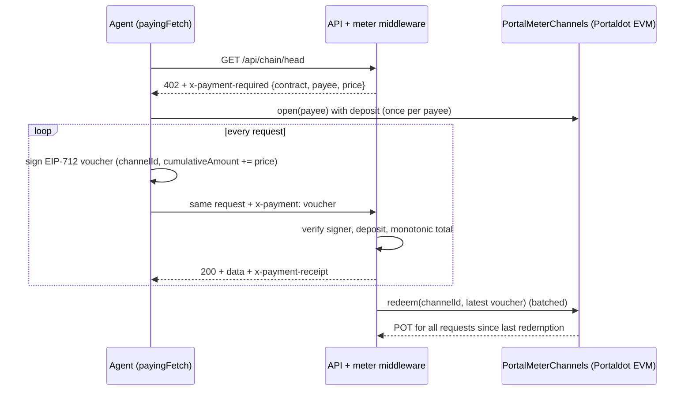

# PortalMeter

**Pay-per-request APIs on Portaldot.** An API answers an unpaid call with HTTP `402 Payment Required`; the client opens one payment channel in native POT and then pays every request with an off-chain signed voucher. The server checks the voucher in milliseconds and redeems the newest one on Portaldot in batches — dozens of paid requests per on-chain transaction.

Built for the Portaldot Hacker House 2026, track **Modular Cloud & Middleware**.

## Why

AI agents and scripts increasingly buy data and compute from APIs, but today that means API keys, monthly plans and card billing — none of which an autonomous agent can set up. Paying on-chain per request fixes the account problem but not the economics: a transaction per call is too slow and costs more than the call is worth.

PortalMeter keeps the open, account-free part of on-chain payments and removes the per-call transaction:

- **One deposit, many calls.** The agent locks POT in a channel once; each request carries a signed voucher for the new running total.
- **No gas per request.** Verifying a voucher is a signature check plus a cached channel read.
- **Batched settlement.** The API operator redeems only the latest voucher, whenever it is worth it.
- **Plain HTTP.** `402` + two headers. Any language can implement the client; the JS SDK does it in one `fetch` wrapper.

## How it works




### Protocol (`portalmeter-channel-v1`)

| Header | Direction | Content (base64url JSON) |
| --- | --- | --- |
| `x-payment-required` | server → client, with `402` | `scheme`, `chainId`, `contract`, `payee`, `price` (wei), `reason`, optional `expected` |
| `x-payment` | client → server | `channelId`, `cumulativeAmount`, `signature` (EIP-712 `Voucher(bytes32 channelId,uint256 cumulativeAmount)`, domain `PortalMeter`/`1`) |
| `x-payment-receipt` | server → client, with `200` | `channelId`, `charged`, `cumulativeAmount`, `remaining` |

A server publishes its price list at `/.well-known/portalmeter`.

### Contract rules (`contracts/PortalMeterChannels.sol`)

- `open(payee)` locks `msg.value`; `topUp` adds to an open channel.
- `redeem(channelId, cumulativeAmount, signature)` — payee only; pays `cumulativeAmount − claimed`; rejects replays, totals above the deposit, foreign or malleable signatures, and vouchers for other channels.
- `requestClose` starts a `closeDelay` window in which the payee can still redeem; afterwards `withdraw` refunds the rest. `release` lets the payee end the window early.

## Why Portaldot

- **Native POT, EVM tooling.** Channels hold native POT through Portaldot V3's EVM compatibility, so standard Solidity, viem and Hardhat work unchanged.
- **One account, two views.** The demo API reads the same account from both sides of the runtime — EVM balance via `eth_getBalance` and native `System.Account` storage via Substrate RPC, using pallet-revive's fallback address mapping (`h160 ++ 0xEE×12`).
- **Ecosystem plumbing.** A metering layer lets anyone on Portaldot sell data, RPC, indexing or AI endpoints to agents without building accounts and billing — every paid call becomes POT demand.

## Repository

| Path | What |
| --- | --- |
| `contracts/PortalMeterChannels.sol` | Payment-channel contract |
| `sdk/client.js` | `createPayingFetch` — handles 402, opens/tops up channels, signs vouchers, keeps requests in voucher order |
| `sdk/server.js` | `createMeter` — `paid(price, handler)` middleware, voucher store, `settle()` |
| `sdk/voucher.js` | Shared EIP-712 voucher and header encoding |
| `sdk/portaldot.js` | Portaldot chain definition, Substrate RPC client, EVM→native address mapping |
| `demo/server.js` | Portaldot Chain Data API: `/api/chain/head`, `/api/account`, `/api/blocks/recent` |
| `demo/agent.js` | Agent that buys chain data per request |
| `demo/dashboard.html` | Live view of requests, channels and settlements (served at `/`) |
| `scripts/deploy.js` | Testnet deployment, writes `deployments/portaldot-testnet.json` |
| `test/` | Contract tests and an end-to-end SDK test over HTTP |

## Quick start

Requires Node.js 22+.

```bash
npm install
npm test
```

### Run the whole demo locally

```bash
npm run node:local
```

In a second terminal (Hardhat's public dev keys, local only):

```bash
export PORTALDOT_EVM_RPC=http://127.0.0.1:8545 DEPLOYMENT_NAME=local
export PAYEE_KEY=0x59c6995e998f97a5a0044966f0945389dc9e86dae88c7a8412f4603b6b78690d
export PAYER_KEY=0xac0974bec39a17e36ba4a6b4d238ff944bacb478cbed5efcae784d7bf4f2ff80
npm run deploy && SETTLE_EVERY_MS=15000 npm run api
```

In a third terminal with the same exports:

```bash
npm run agent -- 5
```

Open http://localhost:8402 to watch requests and settlements. Native-chain fields are read live from the public Portaldot testnet node.

### Run on Portaldot V3 testnet

Testnet: EVM RPC `https://test-evm-rpc-v3.portaldot.dev`, chain id `420420777`, node `wss://test-node-v3.portaldot.dev`.

```bash
cp .env.example .env   # fill PAYEE_KEY and PAYER_KEY with funded testnet keys
npm run compile
node --env-file=.env scripts/deploy.js
node --env-file=.env demo/server.js
node --env-file=.env demo/agent.js 10
```

## Testnet deployment

_Pending testnet funds._ Contract address, deployment transaction and example redemption transactions will be listed here.

## Security notes

- Vouchers are bound to the chain id, the contract and the channel; signatures with high `s` are rejected.
- The server never accepts a voucher whose increment is below the price, and re-checks after every async step so concurrent requests cannot spend the same increment.
- The server stops accepting vouchers 2 minutes before a closing channel's deadline so its last redemption can still land.
- Risk for the operator is bounded by the unredeemed amount; it chooses how often to settle (`SETTLE_EVERY_MS`, `SETTLE_MIN_TPOT`).
- Not audited. Testnet only.

## Roadmap

- ERC-20 channels (USDT on Portaldot) alongside native POT.
- Python client and an Express/Fastify adapter.
- A public directory of PortalMeter-enabled APIs, read from `/.well-known/portalmeter`.
- Metered Portaldot RPC and indexer endpoints as the first production use.

## Credits

Uses [viem](https://viem.sh), [Hardhat](https://hardhat.org), [solc](https://github.com/ethereum/solc-js) and [@polkadot/util-crypto](https://github.com/polkadot-js/common). The HTTP 402 flow is inspired by the x402 standard; the channel design follows classic unidirectional payment channels. Developed with AI coding assistance.

## License

MIT
